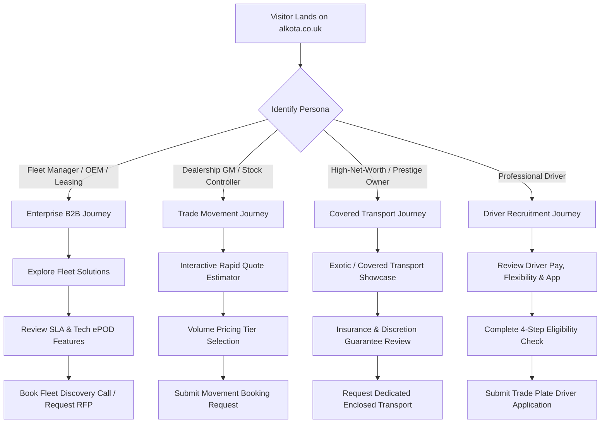

# ALKOTA Architecture & Technical Implementation Plan
**Domain:** `alkota.co.uk` | **Brand:** ALKOTA Automotive Logistics | **Document Version:** 1.0.0 (Master Blueprint)
**Roles:** Principal Product Architect, Senior Creative Developer, Technical SEO Lead, Conversion Strategist

---

## 1. Executive Summary & Strategic Positioning

ALKOTA is conceived as a premier, technology-led UK vehicle movement and automotive logistics platform. By merging the operational scale of legacy providers (BCA Logistics, DMN Logistics) and the agile, automated dispatch mechanics of modern platforms (Engineius) with the bespoke high-end brand pedigree of luxury automotive and creative powerhouses (Red Bull Racing, Trionn), ALKOTA addresses an underserved market segment: **high-trust, tech-native automotive logistics**.

### The Market Problem
* **Legacy providers (BCA, DMN, Gemini):** Reliable in volume but burdened with dated interfaces, opaque communication, low visual trust, and slow legacy inquiry workflows.
* **Tech aggregators (Engineius):** Functional and fast, but visually utilitarian and primarily transactional rather than prestige-led.
* **High-value & EV transport:** Demands white-glove corporate handovers, specialized EV battery state-of-charge management, climate-controlled covered transport, and real-time telemetry-grade proof of delivery (ePOD).

### The ALKOTA Solution
A digital-first, high-performance web platform combining:
1. **Kinetic, High-Performance Visual Identity:** Dark graphite, carbon weave, satin titanium, and electric amber/cyan telemetry accents.
2. **Interactive 3D Transport Experience:** Real-time WebGL/Three.js digital twin of vehicle movement, chassis inspection points, and route telemetry.
3. **Frictionless B2B & B2C Conversion:** Sub-30-second rapid route quoting estimator, multi-persona booking flows, instant SLA calculators, and driver network onboarding.
4. **Dominant Technical SEO Footprint:** Programmatic service, sector, and geographic route coverage with strict Core Web Vitals (CWV) compliance.

---

## 2. Technical Stack Recommendation & Dependency Architecture

### Recommended Core Stack

| Layer | Recommended Technology | Version / Spec | Strategic Rationale & Deviations |
| :--- | :--- | :--- | :--- |
| **Framework** | **Next.js (App Router)** | `v15.x` / `v14.2+` (Node 20/24 LTS) | Server-side rendering (SSR) for programmatic SEO, React Server Components (RSC) to isolate heavy client 3D/GSAP bundles, edge caching, streaming UI. |
| **Language** | **TypeScript** | `v5.x` (Strict mode) | Type-safe domain models for vehicle movement jobs, coordinates, pricing matrices, and telemetry states. |
| **Styling** | **Tailwind CSS** | `v3.4+` (or v4 with CSS variables) | Atomic utility styling with strict design token bindings (`tailwind.config.ts`), container queries, glassmorphism filters, and sub-millisecond compile times. |
| **3D Engine** | **Three.js + React Three Fiber (R3F)** | `three @types/three @react-three/fiber @react-three/drei` | Declarative 3D scene composition in React, modular shader injection, WebGL canvas lifecycle management, and asset pipeline integration. |
| **Animation Orchestration** | **GSAP (GreenSock) + ScrollTrigger** | `gsap` (with `ScrollTrigger`, `useGSAP` hook) | Production gold-standard for complex timeline pinning, parallax, kinetic typography scrubbing, and multi-step scroll choreography. |
| **Smooth Scroll** | **Lenis (`@studio-freight/lenis` or `lenis`)** | Modern headless smooth scroll | Lightweight (under 3KB), thread-friendly inertia scrolling that harmonizes natively with GSAP ScrollTrigger without breaking native browser accessibility. |
| **UI Primitives** | **Radix UI Primitives / Lucide React** | Headless accessible primitives | WAI-ARIA compliant dialogs, popovers, accordions, tabs, and tooltips styled with Tailwind. |
| **Form Handling & Validation** | **React Hook Form + Zod** | `react-hook-form`, `zod` | Zero-re-render form state management with strict schema validation for instant multi-step quote calculations. |
| **State Management** | **Zustand** | Lightweight client state | Reactive UI state for quote builder, interactive 3D camera controls, and navigation drawer without Redux boilerplate. |

### Technical Deviations & Deliberate Architectural Decisions
1. **React Server Components (RSC) vs. Heavy 3D Bundles:**
   * *Challenge:* Three.js and GSAP are client-side libraries (~600KB+ uncompressed). If not managed, they degrade mobile Time to Interactive (TTI) and First Contentful Paint (FCP).
   * *Architecture:* All public SEO pages, editorial layouts, metadata, headers, footers, and text content render strictly via React Server Components. The 3D canvas and GSAP timelines are dynamically imported (`next/dynamic` with `ssr: false`) and load on an intersection observer trigger or secondary idle cycle (`requestIdleCallback`).
2. **Progressive Degradation for Mobile & Low-Power Devices:**
   * If WebGL context creation fails, device pixel ratio is low, or `navigator.hardwareConcurrency < 4`, the 3D canvas smoothly degrades to an ultra-crisp CSS/SVG interactive telemetry card with animated SVG gradients and high-res WebP/AVIF vehicle renders.
3. **Respecting `prefers-reduced-motion`:**
   * All GSAP ScrollTrigger timelines and R3F camera swings observe `window.matchMedia('(prefers-reduced-motion: reduce)')`. When active, scroll scrubbing is disabled, instant snap transitions are used, and 3D rotations freeze to static studio hero angles.

---

## 3. Directory & File Structure (Clean Modular App Router)

```text
alkota-transport/
├── .github/
│   └── workflows/
│       └── ci-cd.yml
├── docs/
│   ├── implementation-plan.md
│   ├── design-system.md
│   ├── seo-architecture.md
│   └── content-plan.md
├── public/
│   ├── 3d/
│   │   ├── vehicle-transporter.glb     # Draco-compressed vehicle / carrier model
│   │   └── environment.hdr             # Low-footprint studio environment map
│   ├── brand/
│   │   ├── logo-light.svg
│   │   ├── logo-dark.svg
│   │   └── favicon.ico
│   ├── images/
│   │   ├── services/
│   │   └── case-studies/
│   └── robots.txt
├── src/
│   ├── app/
│   │   ├── (marketing)/
│   │   │   ├── page.tsx                # Cinematic Homepage
│   │   │   ├── about/
│   │   │   ├── services/
│   │   │   │   ├── page.tsx            # Services Overview
│   │   │   │   ├── trade-plate-delivery/page.tsx
│   │   │   │   ├── covered-vehicle-transport/page.tsx
│   │   │   │   ├── ev-fleet-logistics/page.tsx
│   │   │   │   ├── dealership-dealer-transfers/page.tsx
│   │   │   │   └── inspect-and-collect/page.tsx
│   │   │   ├── fleet-solutions/
│   │   │   │   ├── leasing-companies/page.tsx
│   │   │   │   ├── oem-manufacturers/page.tsx
│   │   │   │   └── corporate-fleets/page.tsx
│   │   │   ├── coverage/
│   │   │   │   └── [city]/page.tsx     # Dynamic UK City Programmatic SEO
│   │   │   ├── technology/page.tsx     # ePOD, Live GPS, Digital Inspection
│   │   │   ├── drivers/
│   │   │   │   └── apply/page.tsx      # Trade Plate Driver Recruitment Funnel
│   │   │   ├── quote/page.tsx          # Multi-Step Instant Quote Calculator
│   │   │   ├── contact/page.tsx
│   │   │   └── legal/
│   │   │       ├── privacy/page.tsx
│   │   │       ├── terms/page.tsx
│   │   │       └── modern-slavery/page.tsx
│   │   ├── api/
│   │   │   ├── quote/calculate/route.ts
│   │   │   ├── leads/submit/route.ts
│   │   │   ├── drivers/apply/route.ts
│   │   │   └── revalidate/route.ts
│   │   ├── layout.tsx                  # Root Layout (Fonts, Lenis, Nav, Footer)
│   │   ├── sitemap.ts                  # Dynamic Programmatic XML Sitemap
│   │   ├── robots.ts                   # Dynamic Crawl Directives
│   │   ├── error.tsx
│   │   ├── not-found.tsx
│   │   └── global.css
│   ├── components/
│   │   ├── 3d/
│   │   │   ├── TransportCanvas.tsx     # Lazy-loaded R3F Canvas
│   │   │   ├── VehicleModel.tsx        # Mesh, materials, textures
│   │   │   ├── RouteMapSpline.tsx      # Kinetic glowing UK trajectory path
│   │   │   └── SceneLighting.tsx       # Studio rim lights & ambient HDRI
│   │   ├── animations/
│   │   │   ├── SmoothScrollProvider.tsx # Lenis wrapper
│   │   │   ├── TextReveal.tsx          # GSAP letter/word split mask
│   │   │   ├── ScrollPinSection.tsx    # GSAP ScrollTrigger pinned section
│   │   │   └── TelemetryCounter.tsx    # Animated numeric metrics
│   │   ├── layout/
│   │   │   ├── Header.tsx              # Sticky dynamic glass HUD navbar
│   │   │   ├── Footer.tsx              # High-density automotive footer
│   │   │   └── MobileNav.tsx           # Fullscreen kinetic overlay
│   │   ├── quote/
│   │   │   ├── QuoteWizard.tsx         # 4-step interactive estimator
│   │   │   ├── VehicleTypeSelector.tsx
│   │   │   ├── MovementTypeToggle.tsx  # Driven vs Covered vs Transporter
│   │   │   └── PostcodeDistanceCalculator.tsx
│   │   ├── ui/                         # Atomic Design Primitives
│   │   │   ├── Button.tsx
│   │   │   ├── Badge.tsx
│   │   │   ├── Card.tsx
│   │   │   ├── Modal.tsx
│   │   │   └── Input.tsx
│   │   └── seo/
│   │       ├── JsonLdSchema.tsx        # Automated Schema Generator
│   │       └── Breadcrumbs.tsx
│   ├── lib/
│   │   ├── gsap.ts                     # GSAP registration & SSR check
│   │   ├── pricing-engine.ts           # Route estimation heuristics
│   │   ├── schema.ts                   # Zod schemas for forms
│   │   └── seo-metadata.ts             # OpenGraph & Meta generators
│   └── types/
│       ├── quote.ts
│       ├── vehicle.ts
│       └── navigation.ts
├── tailwind.config.ts
├── next.config.ts
└── tsconfig.json
```

---

## 4. Homepage Design & Creative Narrative (Section-by-Section)

The ALKOTA homepage is orchestrated as a cinematic narrative that transitions from high-level brand authority to operational precision, technical proof, and conversion:

### Hero Stage: "Kinetic Velocity & Absolute Assurance"
* **Visual Atmosphere:** Deep space graphite (`#0A0D12`), subtle carbon fiber weave textures, animated ambient neon glow in telemetry cyan (`#00F0FF`) and hyper-amber (`#FF5500`).
* **Visual Anchor:** An interactive 3D vehicle silhouette mounted on a bespoke transporter rig. As the user moves the cursor, subtle directional rim-lighting glides across the vehicle’s contour lines.
* **Kinetic Typography:** Split-text reveal: `"PRECISION AUTOMOTIVE LOGISTICS. NATIONWIDE. ON DEMAND."`
* **Real-Time Telemetry HUD:** Overlaying the viewport are subtle dynamic telemetry metrics (live simulated vehicle movements in progress, SLA status: `99.8% On-Schedule`, ePOD verification status: `Active`).
* **Primary Conversion CTAs:**
  1. *[Instant Route Estimate]* (Launches modal/scrolls to interactive calculator).
  2. *[Corporate Fleet Solutions]* (Directs to B2B partnership form).

### Section 2: The ALKOTA Movement Matrix (Interactive Service Segmentation)
* **Design Pattern:** Sticky horizontal scroll or interactive multi-tab switcher featuring 4 core movement divisions:
  1. **Driven Logistics (Trade Plate):** Rapid single-vehicle redistribution across UK auction hubs, lease collections, and dealership swaps.
  2. **Covered & Enclosed Transport:** White-glove, discreet, climate-protected transit for prestige, prototype, and high-value exotics.
  3. **Dedicated EV Logistics:** High-voltage certified drivers, battery health monitoring, and pre-delivery rapid charging protocols.
  4. **Dealership & Corporate Defleet:** Multi-vehicle redistribution, BVRLA fair wear-and-tear appraisals, and digital handover sign-offs.
* **Interactive Element:** Selecting each tab dynamically reorients the 3D canvas (e.g., covered transporter shell activates, EV battery telemetry highlights on the chassis).

### Section 3: The Technology Advantage (Engineius / F1 Telemetry Inspired)
* **Headline:** "Software-Grade Transparency. Zero Black Holes."
* **Feature Grid:**
  * **Digital ePOD App:** 48-point geotagged and timestamped high-resolution photographic inspection at collection and handover.
  * **Live GPS Tracking:** Secure tokenized web link provided to corporate dispatchers and receiving clients.
  * **Automated Job Matching:** Intelligent multi-leg route pairing to eliminate deadhead empty miles and optimize driver transit.
  * **BVRLA & GDPR Compliance:** Automated digital erasure of customer personal navigation and phone pairings (DataClear standard).

### Section 4: Operational Scale & Interactive UK Route Coverage
* **Visual Asset:** An interactive 3D/SVG vector map of Great Britain.
* **Interactive Hotspots:** London Metro, Midlands Hub (Birmingham/Coventry), Northern Corridor (Manchester/Leeds), Scotland (Glasgow/Edinburgh), and South West Hubs.
* **Dynamic Postcode Estimator:** Enter Origin Postcode (e.g., `B1 1AA`) and Destination Postcode (e.g., `M1 1AE`) to immediately calculate approximate transit mileage, estimated transit duration, and recommended transport mode.

### Section 5: The Driver Network Benchmark (Gemini Comparison)
* **Angle:** Why ALKOTA drivers are the industry benchmark:
  * Strict vetting: 5+ years clean UK manual licence, background screening, BVRLA inspection certification.
  * Dedicated corporate travel expenses, digitized daily scheduling, and performance rating algorithms.
  * High-visibility conversion CTA for driver recruitment: *"Join the Premier UK Trade Plate Network"*.

### Section 6: High-Trust Assurance & Governance
* **Badges & Affiliations (Clear Placeholders):** Logistics UK, BVRLA Member Standards, ISO 9001 Alignment, Goods in Transit Comprehensive Insurance (£5M+ commercial indemnity limits pending confirmation).
* **Security & Transparency Guarantee:** Every mile tracked, every handover verified with customer PIN or electronic signature.

### Section 7: Final Conversion Portal & Sticky HUD Footer
* High-contrast, focused quote builder embedded directly on-page, paired with direct contact channels for Enterprise fleet contracts.

---

## 5. Animation, 3D & Performance Engineering Strategy

### 3D Pipeline (Three.js + R3F + Drei)
* **Model Geometry:** Low-poly stylized modern saloon/SUV hybrid chassis (~25,000 polygons maximum), optimized using `gltf-pipeline` with Draco geometry compression and KTX2 basis texture compression.
* **Lighting Model:** Minimalist studio environment. Single directional key light with soft shadow mapping, complementary rim light (`#00F0FF` or electric amber), and an ambient HDRI cubemap (`hdr` compressed to < 150KB).
* **Frame Budgeting:**
  * Locked to 60fps on high-spec desktop; dynamically throttles to 30fps or canvas render-on-demand (`frameloop="demand"`) during idle scroll states to save battery life.
  * IntersectionObserver disables WebGL rendering completely when the canvas scrolls out of viewport.

### GSAP ScrollTrigger Integration
* Unified under `useGSAP` hook from `@gsap/react` to prevent memory leaks and handle hot-module reloading in Next.js.
* Clean pinning sequences for the 4-phase "Movement Matrix" and UK route map zoom sequence.
* Kinetic numeric counters utilizing `gsap.to(counter, { value: target, snap: 1, duration: 2 })`.

---

## 6. Conversion Funnels & Strategic User Journeys

We identify **4 Primary Buyer & Partner Personas**:



### Conversion Rate Optimization (CRO) Tactics:
1. **Sub-30-Second Instant Route Estimator:** Multi-step micro-form that calculates approximate mileage between two UK postcodes without requiring phone number upfront, capturing intent early before requesting contact details for dispatch confirmation.
2. **Persistent Floating Telemetry Bar (Mobile & Desktop):** A compact bottom bar with `[Get Rapid Quote]` and direct WhatsApp/Phone hotline.
3. **Frictionless Driver Application Flow:** Clear step-by-step qualifying criteria (licence age, penalty points, off-road driveway status) to prevent low-quality leads and speed up hiring.

---

## 7. AI Integrations & Roadmap

1. **Intelligent Dynamic Routing & Empty-Leg Pairing:**
   * Algorithmic heuristic matching that pairs inbound delivery runs with outbound trade plate jobs across key UK transit corridors (M1, M6, M4, M25).
2. **AI-Assisted Damage Recognition (Phase 2):**
   * Computer-vision powered appraisal parsing during driver photo upload, flagging pre-existing paint scuffs, curb rash, and windscreen chips before collection sign-off.
3. **Conversational Fleet Concierge (AI Assistant):**
   * Instant NLP assistant trained on ALKOTA operational FAQs, transit time estimates, insurance terms, and driver onboarding requirements.

---

## 8. Acceptance Criteria & Performance Guardrails

* **Core Web Vitals (Desktop & Mobile):**
  * **LCP (Largest Contentful Paint):** < 1.8 seconds on 4G mobile.
  * **INP (Interaction to Next Paint):** < 100ms.
  * **CLS (Cumulative Layout Shift):** < 0.05.
* **Accessibility (WCAG 2.2 Level AA):**
  * Full keyboard navigation for interactive forms and tabs.
  * Color contrast ratio >= 4.5:1 for all textual content.
  * Dedicated ARIA labels and live region announcements for multi-step calculators.
  * Full fallback support when `prefers-reduced-motion` is detected.
* **SEO & Crawlability:**
  * 100% server-rendered semantic HTML for all headings, copy, and link graphs.
  * Zero reliance on client-side JavaScript for indexing core service content.
  * Strict schema markup validation via Google Rich Results test.
